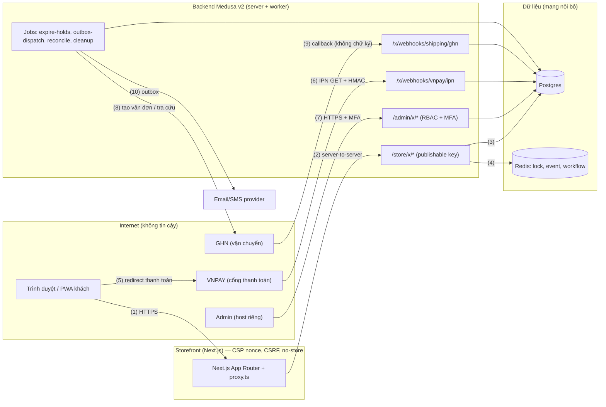

# THREAT-MODEL — x-shop · phiên bản 1.0 · 2026-10-26

> Chủ: phiên chính · Duyệt: chủ dự án chưa duyệt (§9) · Phạm vi: storefront Next.js, Medusa server/worker + Admin,
> Postgres, Redis, VNPAY, GHN, email/SMS · Ngoài phạm vi: hạ tầng cloud cụ thể (chưa chọn — chủ dự án), CDN của bên thứ ba.
> Mô tả theo hệ thống THẬT tại commit sinh tài liệu; mọi đường dẫn ở cột bằng chứng là file có trong repo (kiểm bằng
> `test -f`). "Test" = test chạy trong `pnpm test` / `pnpm test:integration`. Chuẩn nhắm tới: **ASVS 5.0.0 L2** (§7),
> OWASP Top 10:2025 (§6). Không chứa bí mật; tên biến môi trường chỉ để chỉ chỗ cấu hình.

## 1. Tài sản
| ID | Tài sản | Phân loại | Ảnh hưởng nếu lộ / sửa / mất |
|---|---|---|---|
| A-01 | PII khách: họ tên, SĐT, email, địa chỉ | cá nhân cơ bản (Luật 91/2025/QH15 — chưa xác minh văn bản gốc) | pháp lý, uy tín, lừa đảo giao hàng |
| A-02 | Tiền: ledger thu/hoàn, trạng thái thanh toán | toàn vẹn | mất tiền, giao hàng chưa thu |
| A-03 | Tồn kho, reservation | toàn vẹn/sẵn sàng | bán vượt, kẹt hàng |
| A-04 | Bí mật: hash secret VNPAY, token GHN, JWT/cookie secret, `ORDER_LOOKUP_SECRET`, khóa MFA | bí mật | giả IPN, chiếm admin, giả token tra cứu đơn |
| A-05 | Tài khoản admin và quyền | toàn vẹn | toàn quyền shop |
| A-06 | Giá, khuyến mãi, hạn mức coupon | toàn vẹn | bán lỗ |
| A-07 | Audit log, ledger, chứng từ đối soát | toàn vẹn (chỉ ghi thêm) | mất truy vết, chối bỏ |

## 2. Thành phần, ranh giới, luồng
Sơ đồ luồng dữ liệu (số trong ngoặc là mã luồng dùng ở §4):

TB1 Internet↔storefront/API · TB2 API↔DB/Redis · TB3 API↔VNPAY/GHN/email · TB4 Admin↔API · TB5 storefront↔backend
(cùng triển khai, nhưng cookie phiên khách chỉ tồn tại ở storefront; backend nhận token đơn qua header, không qua URL).

Điểm vào có xác thực: `/admin/*` (phiên + RBAC + MFA — `apps/backend/src/lib/admin-security/guard.ts`, map quyền
`apps/backend/src/api/admin/x/permissions.ts`, fail-closed). Điểm vào công khai: `/store/x/*` (publishable key, không đăng nhập),
`/x/webhooks/*` (tin cậy duy nhất là chữ ký/tra lại), `/x/health`. Danh sách đầy đủ + `security` từng route: `docs/design/openapi.yaml`.

## 3. Kẻ tấn công giả định
| Ai | Năng lực | Mục tiêu |
|---|---|---|
| Khách gian lận | trình duyệt, sửa request, nhiều tab/script | giảm giá trái phép, đặt hàng không trả, xem đơn người khác |
| Bot | tốc độ cao, nhiều IP | vét tồn/coupon, dò mã đơn, nhồi đăng nhập admin |
| Kẻ giả IPN/callback | biết endpoint | đánh dấu đã trả/đã giao giả |
| Nhân viên vượt quyền | tài khoản admin vai trò thấp | hoàn tiền, xuất PII |
| Kẻ đánh cắp phiên | XSS/CSRF, cache dùng chung | chiếm giỏ/đơn/admin |

## 4. STRIDE theo luồng
Mức = khả năng × tác động (Cao/Trung/Thấp). Quyết định ∈ mitigate / eliminate / transfer / accept. Trạng thái: **có** = biện
pháp và bằng chứng đã nằm trong repo; **một phần** = còn rủi ro ghi ở §8; **chờ người** = cần chủ dự án.

| ID | Luồng | Loại | Mối đe doạ | Mức | Quyết định | Biện pháp | Bằng chứng | Trạng thái |
|---|---|---|---|---|---|---|---|---|
| T-01 | 6 | Spoofing | IPN giả đánh dấu đã trả | Cao | mitigate | HMAC-SHA512 + so tmn/ref/amount; hộp thư webhook ghi mọi IPN; giới hạn 300 IPN/10 s/IP | `packages/domain/src/providers/vnpay/vnpay.test.ts`; `apps/backend/integration-tests/http/payment-ipn.spec.ts`; `apps/backend/src/api/x/webhooks/vnpay/ipn/route.ts` | có |
| T-02 | 6 | Repudiation/Tampering | IPN lặp ghi thu nhiều lần | Cao | mitigate | UNIQUE(provider, txn_id, kind) trên `payment_ledger`; inbox dedupe; xử lý trong transaction | `apps/backend/src/modules/checkout/models/checkout-models.ts`; `packages/domain/src/ledger/ledger.test.ts`; `apps/backend/integration-tests/http/payment-ipn.spec.ts` | có |
| T-03 | 5 | Tampering | Redirect "thành công" giả qua URL | Cao | mitigate | trang return KHÔNG đổi trạng thái tiền; chỉ `recheck` → server `querydr` cùng giao dịch | `apps/storefront/src/app/(shop)/thanh-toan/ket-qua/order-return.test.ts`; `apps/backend/integration-tests/http/payment-ipn.spec.ts` | có |
| T-04 | 1–2 | Tampering | Client gửi tổng tiền/giá tùy ý | Cao | eliminate | submit/quote không nhận giá/tổng (`z.strictObject`); server `computeQuote` + `diffQuotes`; tiền số nguyên | `packages/domain/src/pricing/quote.test.ts`; `apps/backend/integration-tests/http/checkout-submit.spec.ts`; `apps/backend/src/lib/checkout/http.ts` | có |
| T-05 | 1–2 | DoS/Tampering | Vét tồn/coupon bằng submit song song | Cao | mitigate | khóa Locking Module (Redis) + UNIQUE attempt/cart_version + quota coupon dưới khóa; Idempotency-Key | `apps/backend/integration-tests/http/checkout-submit.spec.ts`; `apps/backend/integration-tests/http/checkout-module.spec.ts` | có |
| T-06 | 1–2 | Info disclosure | IDOR: xem/hủy/đổi trả đơn người khác | Cao | mitigate | token phiên đơn HMAC trong header (không URL); mã đơn+SĐT chỉ gửi liên kết 15 phút; 404 không phân biệt; rate limit theo IP/SĐT/mã; so sánh băm hằng thời gian | `apps/backend/integration-tests/http/order-lookup.spec.ts`; `apps/backend/integration-tests/http/returns-privacy.spec.ts`; `apps/backend/src/api/store/x/orders/lookup/route.ts` | có |
| T-07 | 1, PWA | Info disclosure | CDN/SW cache trang riêng tư | Cao | mitigate | `Cache-Control: private, no-store` trên route đơn/checkout; SW không cache URL có query và trang động | `apps/storefront/src/lib/pwa/cache-policy.test.ts`; `apps/storefront/public/sw.js`; `apps/storefront/src/lib/security/security.test.ts` | có |
| T-08 | 7 | Spoofing/EoP | Chiếm admin bằng mật khẩu | Cao | mitigate | MFA TOTP bắt buộc cho quyền nhạy cảm; rate limit đăng nhập/MFA (email+IP, email, IP) cửa sổ trượt; phiên có hạn tuyệt đối/nhàn rỗi; refresh guard | `apps/backend/integration-tests/http/mfa.spec.ts`; `apps/backend/src/lib/admin-security/__tests__/admin-security.unit.spec.ts`; `apps/backend/src/lib/security/__tests__/sliding-rate.unit.spec.ts` | một phần (băm scrypt — §8) |
| T-09 | 7 | EoP | Kho/CSKH gọi API hoàn tiền, phân quyền | Cao | mitigate | RBAC ở mọi `/admin/*` theo map tập trung, fail-closed; quét thư mục bắt route thiếu khai báo; hoàn tiền cần người thứ hai (cấm tự duyệt) + MFA gần đây | `apps/backend/integration-tests/http/rbac.spec.ts`; `apps/backend/src/api/admin/x/permissions.ts`; `apps/backend/integration-tests/http/refunds.spec.ts` | có |
| T-10 | 9 | Spoofing | Callback GHN giả "đã giao"/COD | Trung | mitigate | không tin nội dung callback: lưu sự kiện đã lọc PII rồi tra lại vận đơn qua API có token trước khi đổi trạng thái; giới hạn 300/10 s/IP | `apps/backend/integration-tests/http/shipping.spec.ts`; `apps/backend/src/api/x/webhooks/shipping/ghn/route.ts`; `packages/domain/src/providers/ghn/ghn.test.ts` | một phần (không chữ ký — §8) |
| T-11 | 1 | Tampering/XSS | Nội dung rich text/CMS/ghi chú chèn script | Trung | mitigate | React escape mặc định; CSP nonce + `strict-dynamic` (test khẳng định không unsafe-inline/unsafe-eval cho script) | `apps/storefront/src/proxy.ts`; `apps/storefront/src/lib/security/security.test.ts` | có |
| T-12 | 1 | Info disclosure | PII trong log/analytics/URL/audit | Trung | mitigate | audit che PII theo tên khóa và giá trị; `maskFreeText` cho ghi chú tự do khi trả ra; sự kiện analytics không PII; token rời URL | `apps/backend/src/lib/audit/sanitize.ts`; `apps/backend/src/lib/audit/__tests__/sanitize.unit.spec.ts`; `apps/backend/integration-tests/http/audit.spec.ts` | có |
| T-13 | 3–4 | Info disclosure | Lộ secret qua bundle/log/commit | Cao | mitigate | env tách server/client, zod che bí mật, test bundle không chứa bí mật; gitleaks quét toàn lịch sử trên PR | `apps/backend/src/lib/env.ts`; `apps/backend/src/lib/__tests__/env.unit.spec.ts`; `apps/storefront/src/lib/client-bundle.test.ts`; `.github/workflows/secret-scan.yml` | có |
| T-14 | upload | Tampering/SSRF | Ảnh/CSV độc, URL ảnh trỏ nội bộ | Trung | mitigate | upload: multipart + `Content-Length` trần trước multer, loại theo magic bytes, đuôi khớp loại thật, presigned URL tắt; CSV import trần 2 MB, kiểm từng dòng, xuất CSV chống công thức | `apps/backend/src/lib/security/upload.ts`; `apps/backend/src/lib/security/__tests__/security.unit.spec.ts`; `apps/backend/integration-tests/http/security.spec.ts`; `apps/backend/integration-tests/http/catalog-import.spec.ts` | một phần (EXIF — §8) |
| T-15 | 4 | DoS | Mất Redis → bán bằng tồn cache/khóa giả | Cao | mitigate | mất khóa → `503 LOCK_UNAVAILABLE` + `Retry-After`, không tạo đơn/giữ hàng; xem catalog vẫn được; diễn tập mất Redis | `apps/backend/integration-tests/http/checkout-lock-outage.spec.ts`; `apps/backend/integration-tests/ops/redis-loss-drill.ts`; `docs/ops/RUNBOOK.md` | có |
| T-16 | 2 | Repudiation | Thao tác nhạy cảm không truy vết | Trung | mitigate | audit log append-only (trigger DB chặn UPDATE/DELETE) ghi actor/lý do/trước-sau; điều chỉnh tồn append-only | `apps/backend/src/modules/audit/migrations/Migration20261024210100.ts`; `apps/backend/integration-tests/http/audit.spec.ts`; `apps/backend/integration-tests/http/inventory-adjust.spec.ts` | có |
| T-17 | 7 | Tampering/Fraud | Hoàn tiền vượt số đã thu hoặc song song | Cao | mitigate | Σ hoàn ≤ Σ thu kể cả khoản đang giữ; trigger DB buộc giữ khóa đơn khi ghi `x_refund`; retry cùng mã yêu cầu, hỏi cổng trước khi gửi lại | `apps/backend/src/modules/returns/migrations/Migration20261026010000.ts`; `apps/backend/integration-tests/http/refund-lock-guard.spec.ts`; `apps/backend/integration-tests/http/refund-guard.spec.ts` | có |
| T-18 | 7 | Tampering | Sửa/xoá chứng từ đối soát | Trung | mitigate | batch, dòng chứng từ và lịch sử chênh lệch chỉ ghi thêm (trigger DB); nhập cùng chứng từ idempotent theo băm nội dung | `apps/backend/src/modules/settlement/migrations/Migration20261025120000.ts`; `apps/backend/integration-tests/http/settlement.spec.ts` | có |
| T-19 | 1 | DoS | Dội request rẻ tiền vào API công khai | Trung | mitigate | rate limit cửa sổ trượt (Postgres cho store, Redis cho login/MFA); IP khách xác định theo hop tin cậy, không tin `X-Forwarded-For` tùy ý | `apps/backend/src/lib/security/sliding-window.ts`; `apps/backend/src/lib/security/client-ip.ts`; `apps/backend/src/lib/security/__tests__/sliding-rate.unit.spec.ts` | có |
| T-20 | 1–2 | Tampering | Đăng ký đơn qua đường native bỏ qua giữ hàng/ledger | Cao | eliminate | chặn `POST /store/carts/:id/complete`; chặn route native ghi tiền/hủy; mọi đường tạo đơn qua checkout tùy biến | `apps/backend/src/api/middlewares.ts`; `apps/backend/integration-tests/http/checkout-submit.spec.ts` | có |
| T-21 | 1, 7 | Tampering | CSRF trên thao tác ghi dùng cookie | Trung | mitigate | storefront `proxy.ts` và backend `csrfGuard` kiểm Origin/Sec-Fetch-Site; `Origin: null` luôn từ chối; request không cookie không là đối tượng CSRF | `apps/backend/src/lib/security/csrf.ts`; `apps/storefront/src/proxy.ts`; `apps/backend/src/lib/security/__tests__/security.unit.spec.ts` | có |

## 5. Quyết định chấp nhận rủi ro (accept) và chuyển giao (transfer)
Không có hàng mức Cao nào ở quyết định `accept`. Các rủi ro còn lại có quyết định `accept`/`transfer` được ghi ở §8 kèm chủ và
điều kiện xem xét lại; hàng `transfer`: thanh toán thẻ (PCI SAQ A — VNPAY giữ PAN, hệ thống không chạm thẻ).

## 6. OWASP Top 10:2025
Mỗi dòng: rủi ro trong hệ thống này → biện pháp đã có (kèm bằng chứng) → rủi ro còn lại.

| ID | Rủi ro trong x-shop | Biện pháp đã có (bằng chứng) | Rủi ro còn lại |
|---|---|---|---|
| A01:2025 Broken Access Control (gồm SSRF) | IDOR đơn/đổi trả; nhân viên vai thấp gọi API tiền; route admin quên khai quyền; SSRF qua URL ảnh/webhook | token phiên đơn + 404 đồng nhất (`apps/backend/integration-tests/http/order-lookup.spec.ts`, `apps/backend/integration-tests/http/returns-privacy.spec.ts`); RBAC map tập trung fail-closed (`apps/backend/src/api/admin/x/permissions.ts`, `apps/backend/integration-tests/http/rbac.spec.ts`); hoàn tiền 2 người (`apps/backend/integration-tests/http/refunds.spec.ts`); adapter chỉ gọi host cấu hình sẵn (VNPAY/GHN), không nhận URL từ người dùng | tên test chưa theo mẫu `api1-bola`/`api5-bfla` (STD-SEC-004); route Medusa native chưa nằm trong OpenAPI tự viết |
| A02:2025 Security Misconfiguration | thiếu header, CORS rộng, tài khoản/secret mặc định, `/static` phục vụ nội dung | header API (CSP `default-src 'none'`, nosniff, HSTS production) `apps/backend/src/lib/security/headers.ts`; CSP nonce storefront `apps/storefront/src/proxy.ts`; env zod, secret dev bị từ chối ở production (`apps/backend/src/lib/env.ts`, `apps/backend/src/lib/__tests__/env.unit.spec.ts`); ghi chú /static ở D-024 | cấu hình hạ tầng thật (TLS, bind, CORS production, Postgres TLS/role) chưa có — chờ chủ dự án (§9) |
| A03:2025 Software Supply Chain Failures | phụ thuộc có lỗ hổng, gói độc, CI bị chiếm | `pnpm-lock.yaml` + `--frozen-lockfile`; Dependabot `.github/dependabot.yml`; action ghim theo SHA (`.github/workflows/secret-scan.yml`); gitleaks toàn lịch sử | chưa có quét lỗ hổng phụ thuộc trong CI (OSV-Scanner/`pnpm audit`), chưa có SBOM, chưa có LICENSE/allowlist license — mở (§8) |
| A04:2025 Cryptographic Failures | lộ PII/bí mật, băm mật khẩu yếu, khóa yếu, token đoán được | token đơn HMAC khóa dẫn xuất theo loại từ `ORDER_LOOKUP_SECRET` ≥ 32 ký tự (`apps/backend/src/lib/env.ts`); chữ ký IPN HMAC-SHA512 (`packages/domain/src/providers/vnpay/vnpay.test.ts`); không lưu thẻ; liên kết tra cứu dùng một lần (UNIQUE SHA-256 token) | mật khẩu admin băm scrypt của `auth-emailpass`, không Argon2id (BE-AUTH-001, quyết định mở); chưa mã hoá cột PII at-rest (dựa vào mã hoá đĩa/managed DB — chờ hạ tầng) |
| A05:2025 Injection | SQL (truy vấn thô trong module), XSS, CSV/công thức, log injection | zod `strictObject` ở mọi route tùy biến (`apps/backend/src/lib/checkout/http.ts`, `apps/backend/src/workflows/returns/http.ts`); truy vấn tham số hoá (`?` binding trong `apps/backend/src/modules/checkout/service.ts`); React escape + CSP nonce; CSV xuất vô hiệu công thức (`apps/backend/integration-tests/http/catalog-import.spec.ts`) | SAST chưa chạy trong CI (CodeQL/Semgrep); chuẩn hoá log CR/LF chưa có test riêng (BASE-ERR-008) |
| A06:2025 Insecure Design | logic nghiệp vụ: bán vượt, hoàn trùng, tin redirect, giá từ client | mô hình đe doạ này; máy trạng thái miền `packages/domain/src/state/state.test.ts`; quote server-side `packages/domain/src/pricing/quote.test.ts`; ledger bất biến `packages/domain/src/ledger/ledger.test.ts`; idempotency + khóa checkout (`apps/backend/integration-tests/http/checkout-submit.spec.ts`); trigger DB hoàn tiền (T-17) | thiếu CHECK DB `stocked_quantity >= reserved_quantity` cho `inventory_level` (IND-ECOM-001, mở); chưa có pen-test/attack run (§8) |
| A07:2025 Authentication Failures | nhồi mật khẩu admin, chiếm phiên, MFA bị bỏ qua, tra cứu đơn bị dò | MFA TOTP + xác thực lại ≤ 5 phút cho thao tác nhạy cảm (`apps/backend/integration-tests/http/mfa.spec.ts`); rate limit đăng nhập/MFA nhiều tín hiệu (`apps/backend/src/lib/admin-security/rate-limit.ts`); phiên có hạn tuyệt đối + nhàn rỗi (`apps/backend/src/lib/admin-security/session.ts`); khách không có tài khoản — không có bề mặt mật khẩu khách | khoá/trì hoãn luỹ tiến theo tài khoản (BE-AUTH-003) chỉ ở mức đếm cửa sổ; chưa chọn Argon2id |
| A08:2025 Software or Data Integrity Failures | IPN/callback giả, file import bị sửa, migration sửa tay | HMAC IPN, GHN tra lại qua API, import preview→commit theo băm file (`apps/backend/integration-tests/http/catalog-import.spec.ts`), append-only audit/ledger/chứng từ (T-16, T-18), migration có đường lùi | callback GHN không có chữ ký (tài liệu GHN chưa xác minh) — dựa vào tra lại có token; ruleset nhánh chưa bật trên remote (§9) |
| A09:2025 Security Logging and Alerting Failures | thiếu truy vết, PII/bí mật trong log, không cảnh báo | audit append-only che PII (`apps/backend/src/lib/audit/sanitize.ts`, `apps/backend/integration-tests/http/audit.spec.ts`); bộ gộp audit lần bị từ chối RBAC (`apps/backend/src/lib/audit/deny-throttle.ts`); ngoại lệ vận hành `ops_exception` + dashboard (`apps/backend/integration-tests/http/reports.spec.ts`) | chưa có log tập trung ngoài máy, NTP, cảnh báo thử kích hoạt (SEC-LOG-006, OPS-ALERT) — chờ hạ tầng |
| A10:2025 Mishandling of Exceptional Conditions | lỗi giữa chừng để lại trạng thái lệch; lộ stack; fail-open khi Redis/cổng lỗi | lỗi trả `application/problem+json` có `code` ổn định, không stack (`apps/backend/src/lib/checkout/errors.ts`); mất khóa → 503 không giữ hàng (`apps/backend/integration-tests/http/checkout-lock-outage.spec.ts`); IPN lỗi → `RspCode 99` để VNPAY gửi lại, ghi trong transaction; reconcile attempt (`apps/backend/src/jobs/reconcile-attempts.ts`); hoàn tiền `unknown` → hỏi cổng, không hoàn trùng (`apps/backend/integration-tests/http/refunds.spec.ts`) | thân lỗi chưa có `trace_id` (BASE-ERR-003); trang lỗi Admin native do Medusa quản |

## 7. ASVS 5.0.0 L2
Chuẩn nhắm tới: **ASVS 5.0.0 L2** (chọn lọc theo bề mặt thật; ghi trong `PROJECT.md` §5). Đối chiếu theo chương, chỉ nêu cái có bằng chứng:

| Chương | Yêu cầu trọng tâm | Trạng thái | Bằng chứng / ghi chú |
|---|---|---|---|
| V1 Encoding & Sanitization | mã hoá đầu ra, chống injection | đạt phần lớn | React escape, CSP nonce `apps/storefront/src/lib/security/security.test.ts`; zod strict ở biên |
| V2 Validation & Business Logic | validate allowlist, logic nghiệp vụ chống lạm dụng | đạt | `apps/backend/src/lib/checkout/http.ts`; `packages/domain/src/pricing/quote.test.ts`; idempotency `apps/backend/integration-tests/http/checkout-submit.spec.ts` |
| V3 Web Frontend Security | CSP, header, cookie, CSRF | đạt | `apps/storefront/src/proxy.ts`; `apps/backend/src/lib/security/headers.ts`; `apps/backend/src/lib/security/csrf.ts` |
| V4 API & Web Service | hợp đồng API, lỗi, giới hạn | đạt phần lớn | `docs/design/openapi.yaml`; `scripts/check-openapi.mjs`; chưa có `oasdiff` trong CI (STD-API-008) |
| V5 File Handling | upload, kích thước, loại | đạt phần lớn | `apps/backend/src/lib/security/upload.ts`; còn EXIF (§8) |
| V6 Authentication | MFA, mật khẩu, chống brute-force | một phần | `apps/backend/integration-tests/http/mfa.spec.ts`; scrypt (§8) |
| V7 Session Management | phiên, hết hạn, đăng xuất | đạt phần lớn | `apps/backend/src/lib/admin-security/session.ts`; cookie phiên khách HttpOnly ở storefront |
| V8 Authorization | RBAC, BOLA/BFLA, tách nhiệm | đạt | `apps/backend/integration-tests/http/rbac.spec.ts`; `apps/backend/integration-tests/http/returns-privacy.spec.ts` |
| V9 Self-contained Tokens | token đơn/liên kết | đạt | HMAC khóa dẫn xuất theo loại, hết hạn, đổi một lần (`apps/backend/integration-tests/http/order-lookup.spec.ts`) |
| V11 Cryptography | thuật toán, khoá | đạt phần lớn | HMAC-SHA512/SHA-256; khoá ≥ 32 ký tự `apps/backend/src/lib/env.ts` |
| V12 Secure Communication | TLS | chờ hạ tầng | HSTS bật ở production; TLS thật do hạ tầng (§9) |
| V13 Configuration | secret, cấu hình, bản dựng | đạt phần lớn | env zod; gitleaks; thiếu SBOM/quét phụ thuộc |
| V14 Data Protection | phân loại, tối thiểu hoá, retention | một phần | `docs/ops/DPIA.md`; retention thực thi mới có `apps/backend/src/jobs/order-access-cleanup.ts` |
| V15 Secure Coding & Architecture | thư viện, kiến trúc | đạt phần lớn | `docs/adr/0001-stack.md`; Dependabot |
| V16 Security Logging & Error Handling | log, audit, lỗi | một phần | `apps/backend/integration-tests/http/audit.spec.ts`; thiếu log tập trung |
| V17 WebRTC | — | không áp dụng | hệ thống không dùng WebRTC |

Mã chương theo ASVS 5.0.0; chi tiết từng yêu cầu con (V*.*.*) chưa được đối chiếu từng dòng — việc đánh giá ASVS L2 đầy đủ
là bước của kiểm thử bảo mật độc lập trước G7 (§9).

## 8. Rủi ro còn lại (kỹ thuật, tự xử lý được)
| ID | Rủi ro | Mức | Quyết định | Ghi chú / điều kiện xem xét lại |
|---|---|---|---|---|
| R-01 | Callback GHN không chữ ký | Trung | accept (có biện pháp bù: tra lại API có token) | xem lại khi có tài liệu chữ ký/IP allowlist của GHN |
| R-02 | Băm mật khẩu admin scrypt (không Argon2id) | Trung | accept tạm | Medusa `auth-emailpass` cố định; nâng `hashConfig` hoặc provider riêng — quyết định mở |
| R-03 | Upload chưa xoá EXIF/GPS | Thấp | accept | cần thư viện xử lý ảnh; ảnh sản phẩm do shop tải, không phải PII khách |
| R-04 | Chưa quét lỗ hổng phụ thuộc/SAST/SBOM trong CI | Trung | mitigate | thêm bước CI — việc ngoài tài liệu, chuyển phiên chính |
| R-05 | `maskFreeText` là heuristic, có thể sót địa chỉ không có cụm báo hiệu (D-036) | Thấp | accept | ghi chú tự do chỉ hiển thị cho nhân viên có quyền |
| R-06 | Chưa có CHECK DB tồn `stocked >= reserved` (IND-ECOM-001) | Trung | mitigate | migration mới, không sửa migration cũ |

## 9. Rủi ro còn mở (chờ người)
| ID | Việc | Chủ | Hệ quả nếu chưa làm |
|---|---|---|---|
| O-01 | Ruleset nhánh `main` đang tắt trên remote (file mẫu `.github/rulesets/main.json` đặt `active`); bật và đòi check `quality`, `gitleaks` | chủ dự án (quyền admin repo) | merge không bị chặn bởi CI ở tầng nền tảng |
| O-02 | Khoá merchant thật VNPAY (TMN code, hash secret) và token/shop GHN; hiện dev/CI dùng mock/fixture | chủ dự án | IPN/refund/querydr thật chưa kiểm (`faithful-fixture`) |
| O-03 | Staging + production, tên miền, TLS, Postgres TLS/role riêng, backup PITR, log tập trung | chủ dự án | A02/A09/V12 chưa chứng minh; RPO/RTO chưa diễn tập trên hạ tầng thật |
| O-04 | `LICENSE` (chưa có) và allowlist license phụ thuộc | chủ dự án | không rõ điều khoản sử dụng/phân phối |
| O-05 | Kiểm thử tấn công thử (`attack`: DAST/fuzz) và hiệu năng (`perf`) trên bản chạy thật | chủ dự án + phiên chính | GO-NO-GO còn BLOCKER (xem `GO-NO-GO.md`) |
| O-06 | Duyệt threat model này và đánh giá ASVS L2 từng yêu cầu con | chủ dự án / người bảo mật | cổng G4 chưa đóng |

## 10. Lịch sử
| Phiên bản | Ngày | Thay đổi |
|---|---|---|
| 0.1 | 2026-10-24 | nháp 16 mối đe doạ theo kế hoạch |
| 1.0 | 2026-10-26 | theo hệ thống thật: DFD mermaid, STRIDE có quyết định + bằng chứng, OWASP Top 10:2025, ASVS 5.0.0 L2, rủi ro còn mở |
